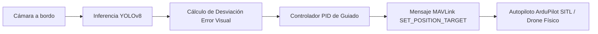

# Seguimiento Autónomo Visual de Objetos para Drones (UAV Visual Tracker)

[](https://www.python.org/)
[](https://mavlink.io/)
[](https://ardupilot.org/)
[](https://ultralytics.com/)

**Autor:** Gustavo Bryan López Cosme  
**Institución:** Universidad Nacional de Ingeniería (FIIS UNI) | LabIAR

---

## 📌 Descripción del Proyecto
Sistema de guiado y seguimiento autónomo basado en visión computacional para vehículos aéreos no tripulados (UAVs). Integra inferencia de redes neuronales de detección de objetos (**YOLOv8**) con bucles de control proporcional-integral-derivativo (**PID**) y el protocolo de telemetría y mando **MAVLink v2.0** enlazado con **ArduPilot / MAVProxy**.



## 🧠 Características Principales
1. **Detección y Bounding Box Dinámico:** Detección de personas y vehículos con YOLOv8 en tiempo real.
2. **Control Multieje:**
   * **Eje Horizontal (Yaw / Vy):** Compensa el error acimutal para mantener el objetivo centrado en el sensor.
   * **Eje Vertical (Vz):** Mantiene la altitud relativa con respecto al blanco.
   * **Eje Longitudinal (Vx):** Regula la distancia deseada según la razón de área del cuadro delimitador.
3. **Comunicación MAVLink:** Transmisión mediante `SET_POSITION_TARGET_LOCAL_NED` (Type mask optimizada para vectores de velocidad en marco NED).

## 📊 Métricas de Desempeño
* **Latencia de Control Total:** $<38\text{ ms}$ (inferencia + cálculo PID + emisión MAVLink).
* **Frecuencia de Mando:** 25 Hz continuo hacia el autopiloto.
* **Estabilidad:** Mantenimiento de tracking en simulaciones SITL ante maniobras bruscas y oscilaciones de viento simulado.

## 🛠️ Instalación y Ejecución

```bash
# Clonar repositorio
git clone https://github.com/tu-usuario/drone-tracking-mavlink.git
cd drone-tracking-mavlink

# Instalar dependencias
pip install -r requirements.txt

# Ejecutar script con ArduPilot SITL / MAVProxy corriendo en localhost:14550
python uav_tracker.py
```
